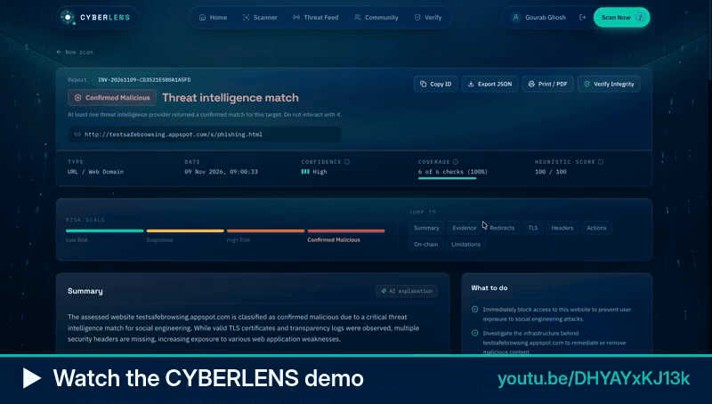
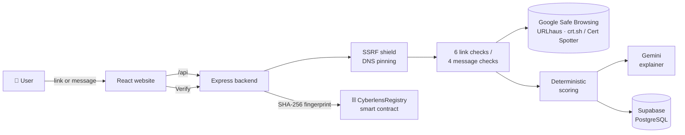

<div align="center">

# 🛡️ CYBERLENS

### See the Threat. Trust the Web.

**An AI-powered threat-intelligence platform that inspects suspicious links and messages, explains the risk in plain language, and anchors every verdict on the blockchain so nobody can quietly rewrite it.**


<a href="https://youtu.be/DHYAYxKJ13k" title="Watch the CYBERLENS demo on YouTube">
  
</a>

**[▶ Watch the full demo video](https://youtu.be/DHYAYxKJ13k)** · **[🌐 Try it live](https://cyberlens-liart.vercel.app)**


*Built by **Team CHAKRA** for **HackMatrix***

</div>

---

## 🚨 The problem

Every day people receive messages like *"Your SBI account will be blocked today. Update KYC at this link and share your OTP."*

Most of them can't tell whether a link is safe. The tools that exist:

- give a bare "safe / unsafe" with no reasons;
- call a site "safe" just because it isn't on a list yet;
- produce results that can be changed later, with no proof of what was originally found.

## 💡 Our solution

CYBERLENS is a **digital trust lens**. Paste a link or a message and in a few seconds you get:

1. **A clear verdict**, decided by fixed, transparent scoring rules rather than by a guessing AI.
2. **Evidence**: every check that ran, what it found, and which checks could not run.
3. **A plain-language explanation** written by Gemini AI, which explains the verdict but can never change it.
4. **Tamper-proof proof**: the report's SHA-256 fingerprint is anchored in a smart contract, so anyone can later verify that the report was never altered.
5. **Community intelligence**: users report scams, vote on them, and moderators validate them.

---

## ✨ Features

| | Feature | What it does |
|---|---|---|
| 🔗 | **Link scanner** | 6 checks: Google Safe Browsing, URLhaus, look-alike domains, TLS certificate, certificate-transparency logs, security headers |
| 💬 | **Message scanner** | 4 checks: scam indicators, pressure tactics (with highlighted phrases), threat intel on every link, brand-vs-domain mismatch. |
| 🧠 | **AI explanations** | Gemini writes the summary, key points and advice. A guard discards any text that contradicts the real verdict, and a template takes over if the AI fails. |
| ⛓️ | **Blockchain registry** | Register a report on-chain, then verify it later with a match / mismatch / not-registered answer that is never faked |
| 📡 | **Threat Feed** | Public feed of registered reports, with raw links hidden |
| 👥 | **Community** | Submit scam reports, one confirm/dispute vote per person, admin validation and on-chain anchoring |
| 🔐 | **Accounts** | Register, login, logout, user and admin roles |
| 🗄️ | **Persistent storage** | Supabase (PostgreSQL), with an automatic in-memory fallback for offline demos |

### Five honest verdicts

| Verdict | Meaning |
|---|---|
| 🟢 **Low Risk** | No significant warning signs in the checks that ran (never called "safe") |
| 🟡 **Suspicious** | Some warning signs; be careful |
| 🟠 **High Risk** | Strong phishing or scam signs; do not act on it |
| 🔴 **Confirmed Malicious** | Listed by Google Safe Browsing or URLhaus; only a real match can produce this |
| ⚪ **Inconclusive** | Not enough checks completed to judge |

> **Our honesty rule:** a check that could not run is shown as *unavailable* and is **never** counted as clean.

---

## 🏗️ How it works



1. The website sends the link or message to the backend. The website never touches the database or any secret key.
2. The **SSRF shield** refuses private, local and cloud-metadata addresses, then resolves DNS once and pins the IP.
3. The checks run in a background queue, and the website shows live progress.
4. **Scoring rules** decide the verdict. **Gemini** only explains it.
5. The report is stored in **Supabase**. For privacy, the original message text is deleted right after analysis.
6. On **Register on-chain**, a canonical snapshot of the report is hashed (SHA-256) and written to the contract. **Verify** re-hashes the report and compares it with the chain.

---

## 🧰 Tech stack

| Layer | Technology |
|---|---|
| Frontend | React 18, Vite 5, Tailwind CSS, Framer Motion, React Router |
| Backend | Node.js, Express, Zod validation, Helmet, express-session, express-rate-limit |
| Database | Supabase (PostgreSQL + PostgREST), Row Level Security |
| AI | Google Gemini (`gemini-3.5-flash-lite`) with a template fallback |
| Threat intel | Google Safe Browsing v4, URLhaus (abuse.ch), crt.sh and Cert Spotter |
| Blockchain | Solidity 0.8.24, Hardhat, ethers v6; local chain or Sepolia testnet |
| Testing | node:test + supertest (backend), Hardhat + Chai (contracts) |

## 🔒 Security built in

- **Passwords:** Argon2id (OWASP settings). Login answers take the same time either way, so attackers can't tell which accounts exist.
- **Sessions and requests:** HttpOnly SameSite session cookies, CSRF tokens plus an Origin check, a CORS allow-list, and rate limits on login, register, scans and votes.
- **Scanner:** the SSRF shield with DNS pinning, checked again on every redirect.
- **Secrets:** the Supabase secret key stays on the server, every table has RLS on, and the public anon key is refused.
- **AI:** it receives only structured findings, never raw page content or message text.
- **Production:** the backend refuses to start with an unsafe configuration.

---

## 🚀 Run it locally

**Requirements:** Node.js 20.12+ (tested on 22 and 24), macOS or Linux.

```bash
git clone https://github.com/TEAM-CHAKRA/Hackmatrix-project.git
cd Hackmatrix-project
bash start-cyberlens.sh
```

That one command does everything:

1. Installs dependencies.
2. Starts a local blockchain and deploys the contract.
3. Fills in `backend/.env` and creates an admin account.
4. Starts the backend and the website. Then open **http://localhost:5173**.

Press **Ctrl+C** to stop.

### Optional keys (`backend/.env`)

Copy `backend/.env.example` to `backend/.env`, then add whichever keys you have. Without a key, that check shows *unavailable*, never *safe*.

| Setting | Enables |
|---|---|
| `SUPABASE_URL`, `SUPABASE_SERVICE_ROLE_KEY` | Permanent storage. See [backend/docs/DATABASE.md](backend/docs/DATABASE.md). |
| `GOOGLE_SAFE_BROWSING_API_KEY` | Google's phishing and malware list |
| `URLHAUS_API_KEY` | abuse.ch malware URL database |
| `CERTSPOTTER_API_KEY` | Certificate-log fallback |
| `GEMINI_API_KEY` | AI-written explanations |

**Demo mode** (website only, sample data, no backend):

```bash
cd frontend && npm install && npm run dev:demo
```

---

## ✅ Testing

```bash
cd backend   && npm test          # 180 tests: auth, scanners, scoring, queue, community, registry on a real local chain, HTTP integration
cd backend   && npm run db:check  # is Supabase connected and set up?
cd contracts && npm test          # 12 smart-contract tests
```

- The full backend suite passes on **both** the in-memory database and the Supabase database.
- A live end-to-end run covered the whole site: scans, Google's test phishing page detected, a private address blocked, on-chain register and verify, community moderation, and permission checks. Every step passed.

---

## 📁 Project structure

```
Hackmatrix-project/
├── frontend/              React website (pages, components, API client, demo mode)
├── backend/
│   ├── src/
│   │   ├── controllers/   auth, health, investigations, community, registry
│   │   ├── services/      checks, threat intel, scoring, AI explainer, hashing, blockchain
│   │   ├── middleware/    session, CSRF, auth, rate limits, validation, errors
│   │   ├── jobs/          background investigation queue
│   │   └── store/         repository: in-memory and Supabase
│   ├── supabase/          schema.sql (tables, RLS, functions)
│   ├── test/              180 automated tests
│   └── docs/              SETUP, API, DATABASE, HANDOVER
├── contracts/             CyberlensRegistry.sol, Hardhat tests, deploy script
├── docs/                  API contract and backend specification
└── start-cyberlens.sh     one-command local start
```

## 📚 Documentation

| Doc | For |
|---|---|
| [backend/docs/SETUP.md](backend/docs/SETUP.md) | Running everything, Sepolia deployment, production checklist |
| [backend/docs/API.md](backend/docs/API.md) | Every endpoint with examples |
| [backend/docs/DATABASE.md](backend/docs/DATABASE.md) | Connecting Supabase step by step |
| [backend/docs/HANDOVER.md](backend/docs/HANDOVER.md) | What was built and changed |
| [contracts/README.md](contracts/README.md) | The smart contract |
| [frontend/README.md](frontend/README.md) | The website |

---

## 🗺️ What's next

- [ ] Deploy the registry contract to the public **Sepolia** testnet, with Etherscan links
- [ ] A browser extension that scans links before you click
- [ ] WhatsApp and SMS forwarding bot for one-tap message checks
- [ ] Hindi, Hinglish and regional-language scam-tactic detection

---

<div align="center">

**CYBERLENS** · Team CHAKRA · HackMatrix

*See the Threat. Trust the Web.*

</div>
